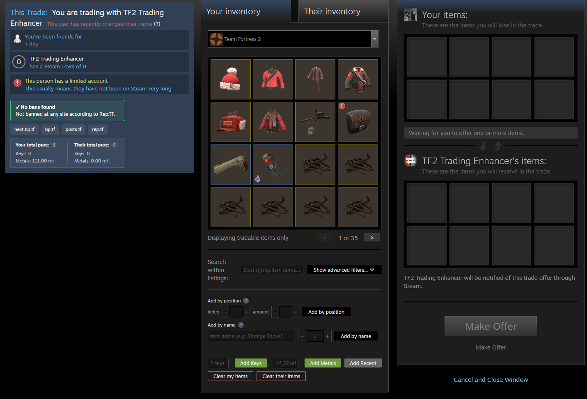
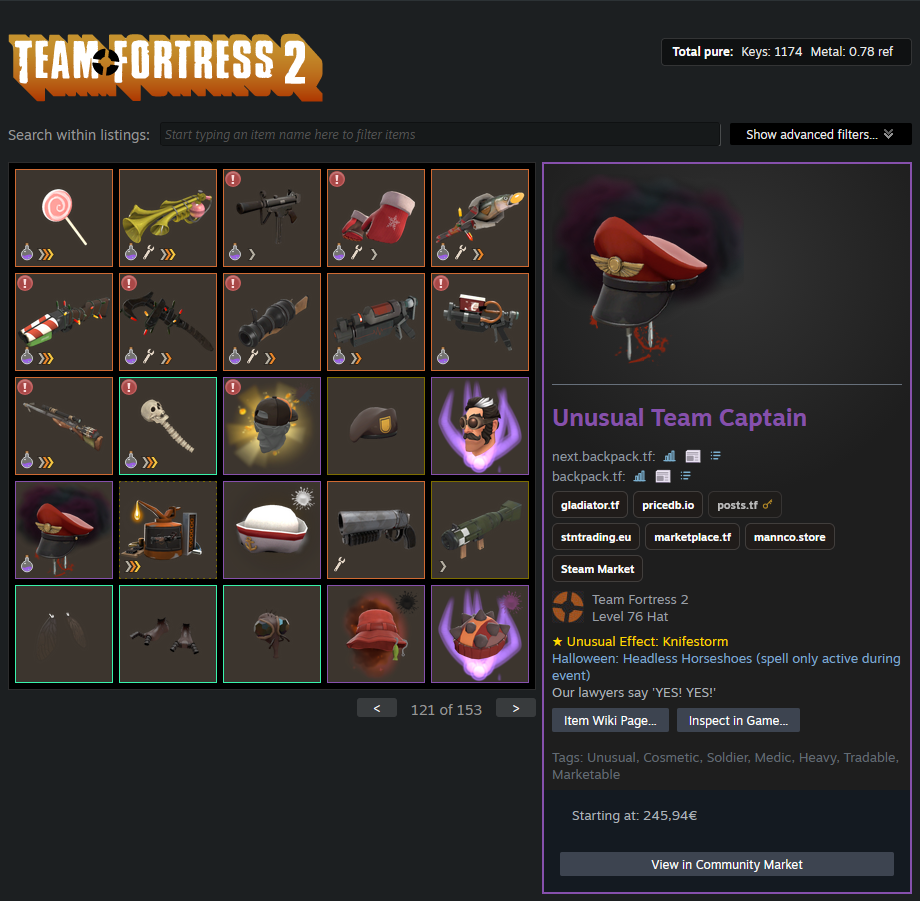
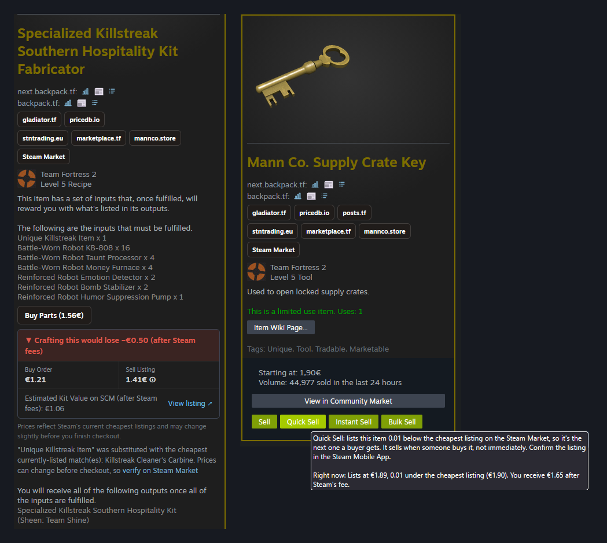
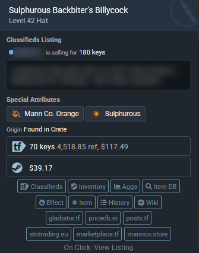
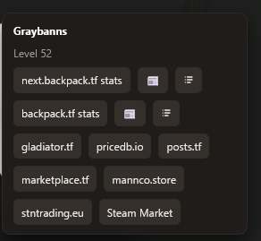
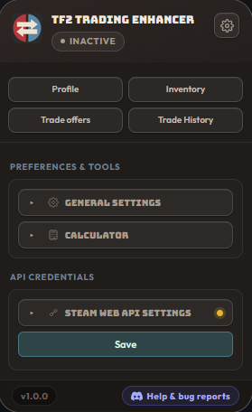

# TF2 Trading Enhancer

**Trading tools for Team Fortress 2 traders, right on the sites you already
use.** A browser extension for Firefox and Chrome that rebuilds the Steam
trade-offer page, links every item to the same item on the other trading
sites, and adds bulk-selection and pricing helpers across Steam, backpack.tf,
scrap.tf, stntrading.eu, marketplace.tf, mannco.store and posts.tf.

## Contents

- [Highlights](#highlights)
- [Supported sites](#supported-sites)
- [Install](#install)
- [Setup (optional Steam Web API key)](#setup-optional-steam-web-api-key)
- [Features](#features)
- [Privacy and security](#privacy-and-security)
- [FAQ](#faq)
- [Help and bug reports](#help-and-bug-reports)
- [Contributing](#contributing)
- [Credits](#credits)
- [Disclaimer](#disclaimer)
- [License](#license)

## Highlights

- **A better trade-offer page.** Item summaries for both sides, duplicates
  collapsed into "×N", add items by name, keys and metal in one click, and
  each side's total pure.
- **One click to the same item anywhere.** Links from Steam, backpack.tf,
  scrap.tf and the other sites to the exact same item elsewhere (quality,
  Unusual effect, Killstreak tier, paint, spell, skin), with price history.
- **Unusual effects you can see.** Effect backgrounds and Strange / Spell /
  Killstreak markers on Steam inventory, Market and profile tiles.
- **Trade offer alerts.** A toolbar badge and a sound when a new offer
  arrives: five built-in sounds or your own, with a volume slider.
- **Bulk helpers.** Select duplicates on scrap.tf and stntrading.eu, pick
  auction bid currency on scrap.tf, decline all active offers on Steam, sell on
  the Steam Market in one click.
- **Scam protection.** Trade links can't pre-fill items unless you opened them
  on backpack.tf yourself, rep.tf ban checks on trade partners and profiles,
  and a warning on Steam's API key page when the key there isn't yours.
- **Private by design.** Everything runs in your browser. No account, no
  tracking, no data collection.

## Supported sites

| Site | What you get |
|---|---|
| **Steam** (trade offers, inventory, Market, profiles, trade history) | Rebuilt trade-offer page, new offer alerts, item quick-links, effect overlays, Quick/Instant Sell, Kit Fabricator helper, ban checks, API key scam warning |
| **backpack.tf** (classic and next) | Quick-link buttons, Killstreak tier switcher, classifieds filters, fixed trade-offer links, Listing Queue, inventory grouping |
| **scrap.tf** | Item cards with every outbound link, duplicate selection, auction bid helper |
| **stntrading.eu** | Links to every other site, Select All / Select Duplicates |
| **marketplace.tf** | Price in keys under every price, item quick-links |
| **mannco.store**, **posts.tf** | Item quick-links |

## Install

TF2 Trading Enhancer is coming soon to **Firefox Add-ons** and the **Chrome
Web Store**. Once it is listed, install it from your browser's store, and it
updates automatically.

## Setup (optional Steam Web API key)

Nothing is required: the extension works right after installing. A free
**Steam Web API key** of your own, from
[steamcommunity.com/dev/apikey](https://steamcommunity.com/dev/apikey), adds:

- **Trade offer alerts**: without the key, new offers aren't checked at all
  (an amber dot on the Steam section reminds you).
- **The item schema** (names, effects) and some links (posts.tf in
  particular). Most Unusual effects work without it, from a bundled table of
  about 500 effects.

Add it on the settings page (the ⚙ in the toolbar popup) under **API keys**,
or in the popup under **Steam Web API settings**. The **Check** button makes
one real request to confirm the key works. The key is stored only in your
browser; see [Privacy and security](#privacy-and-security).

## Features

### Steam trade offers

A rebuilt trade-offer page, based on the open-source
[steam-trade-offer-enhancer](https://github.com/juliarose/steam-trade-offer-enhancer)
userscript:

- **Item summaries** under each side, with identical items grouped into "×N"
  (items with a Strange Part, Killstreak Kit or Spell are counted separately),
  linking to that side's backpack.tf inventory.
- **Duplicate collapsing** in the trade slots: one tile with an "×N" badge and
  a "−" button to remove any quantity.
- **Item history link** on every traded item (next.backpack.tf), with a picker
  for collapsed stacks.
- **Add by name** (with autocomplete, any game, either side), **Add by
  position**, **Add Keys / Add Metals / Add Recent**, **Clear my / their
  items**.
- **Total pure** for your inventory and theirs.
- **rep.tf ban check** banner for the trade partner.
- **Listing links from backpack.tf**: opening a trade from a listing pre-adds
  the listed item and its price in keys and metal, or, for a buy order, a
  matching item from your inventory. **Add More Listed Items** and **Add
  requested pure** do the same on demand. This only happens for links you
  opened on backpack.tf yourself (see
  [Privacy and security](#privacy-and-security)), and it can be turned off in
  the popup.
- **Toolbar badge and sound** for new incoming offers (needs the Steam Web API
  key; pick one of five sounds or use your own), and **Decline All Active…**
  on the trade offers list (asks for confirmation first).
- On the trade offers list, **next.bp.tf / bp.tf / posts.tf / rep.tf**
  buttons for each received offer's partner (each opens in a new tab), and an
  item summary under each offer.

### Steam inventory, Market and profiles

- **Item quick-links** on inventory items and Market listings: next.backpack.tf,
  backpack.tf, gladiator.tf, pricedb.io, posts.tf, marketplace.tf,
  mannco.store, stntrading.eu and Steam Market, matched to the exact item
  (quality, Unusual effect, Killstreak tier, sheen and killstreaker, paint,
  spell, skin, crate series, Strangifier target), each with a price-history
  icon.
- **Item icon overlays**: Unusual effect backgrounds and Strange / Spell /
  Strange Part / Killstreak markers on inventory, Market and profile showcase
  tiles, and the effect behind the large picture of the selected item. The
  Killstreak marker shows the tier: one chevron for Killstreak, two for
  Specialized, three for Professional.
- **Market listings**: each listing's Unusual effect behind its picture,
  without opening it.
- **Quick Sell / Instant Sell / Bulk Sell** next to Steam's Sell button (just
  under the lowest listing, or at the highest buy order), for any game. A
  confirmation shows the price and what you receive after Steam's fee.
- **Kit Fabricator "Buy Parts"**: one Steam multibuy link for every part a
  Specialized or Professional Killstreak Kit Fabricator needs, plus a card
  estimating the profit or loss of crafting it.
- **Profile quick-links** (next.backpack.tf, backpack.tf, posts.tf, rep.tf,
  steamdb.info) and a rep.tf ban banner on Steam profiles.
- **API key scam warning** on `steamcommunity.com/dev/apikey`: a red warning
  if the page shows a key that isn't the one you saved. In the "API key scam",
  a scammer registers a key on your account to watch and swap your trades.
- **Trade history**: repeated items in each trade collapsed into "×N", on
  `/tradehistory/` and `/inventoryhistory/`.

### backpack.tf

Most features work on both classic backpack.tf and next.backpack.tf.

- **Quick-link buttons** (gladiator.tf, pricedb.io, posts.tf, stntrading.eu,
  marketplace.tf, mannco.store) in item tooltips, on `/stats` pages and on
  price suggestion pages.
- **Killstreak tier switcher** on `/stats` and tier buttons on `/classifieds`.
- **Trade-offer link fix**: adds the item, price and item name to each
  listing's trade link, so the Steam trade page can pre-fill it.
- **Classifieds filters**: hide or show spelled items, Strange items and War
  Paints; Killstreak tier buttons; a live text filter (classic).
- **Spell highlight** borders and **click-to-copy item names**.
- **Listing Queue** (classic, your own inventory): Ctrl+click items to queue
  sell listings, edit their prices, then publish them all at once.
- **Inventory "Group by"** (classic): level, paint, effect, spell, price,
  killstreak details.
- **Premium Search** highlights (owner online status, recent sale age) and
  skin autocomplete, for backpack.tf Premium accounts.
- **Effects / Unusuals / Items** page filters: category grouping, class and
  quality filters.

### scrap.tf

- **Item card**: hover an item and middle-click for a card with every outbound
  link and price history.
- **Items table links** (`/items`): a "Links ▾" menu on every row.
- **Select Duplicates** on sell pages and an **Auction Bid Helper** (type an
  amount, it selects the matching metal and key tiles), both with a Stop
  button.

### stntrading.eu, marketplace.tf, mannco.store, posts.tf

- **stntrading.eu**: links to every other site on item pages, and **Select All
  / Select Duplicates (keep 1)** on the sell page, with a Stop button.
- **marketplace.tf**: "≈ X.XX keys" under every price, and an item quick-links
  row on item pages.
- **mannco.store** and **posts.tf**: an item quick-links row on item pages.

### Toolbar popup

- The features active on the current tab.
- Links to your Steam profile, inventory, trade offers (with the pending
  count) and trade history.
- **Settings**: the trade offer sound (mute, five built-in sounds or your own
  file, volume and a Play preview), auto-add listing prices, filter links by
  sheen and killstreaker, and the Steam Web API key.
- **Calculator**: keys, refined, reclaimed and scrap to a total in keys and
  money (with the key price you enter), plus quick ×, ÷, + and −.
- **⚙** opens the settings page.

### Settings page

The same settings as the popup, in a tab with room and full explanations:
general settings, trade offer alerts and API keys. Open it with the ⚙ in the
popup, or from your browser's add-on list (Firefox: `about:addons` → the
extension → Options; Chrome: right-click the toolbar icon → Options).

- **Trade offer alerts**: mute, the sound list (picking one plays it; the
  arrow keys step through them), volume, and your own sound file (MP3, OGG or
  WAV, up to 10 seconds and 1 MB), picked right on the page.
- **API keys**: the Steam Web API key, with **Check** and **Save**. Amber
  dots in the side menu show while it's missing.

The popup and the settings page stay in sync: a change in one shows up in the
other right away.

## Privacy and security

- **No data collection.** No analytics, no tracking, no account. See
  [PRIVACY.md](PRIVACY.md).
- **No third-party fonts or images.** Fonts and icons ship with the
  extension; the only pictures it fetches are the larger Unusual effect
  images, from its own image host.
- **Your keys stay in your browser.** API keys are stored in the extension's
  local storage and sent only to the API they belong to (the Steam key only to
  `api.steampowered.com`). Website scripts can never read them.
- **No automatic trading.** The extension never sends or accepts a trade. It
  only fills in the trade-offer page; you review it and click Send yourself.
- **Trade links can't be weaponised.** The trade page only pre-fills items or
  currency for a backpack.tf listing link you clicked yourself in the last 10
  minutes. Links from chat, forums or anywhere else fill in nothing.
- **Limited network access.** The extension's background script only makes
  https requests to the hosts listed in the [permissions](#permissions), and
  refuses any other host.

### Permissions

| Permission | Why |
|---|---|
| `storage` | Keys, settings (including your own alert sound) and caches. |
| `alarms` | Check the pending trade offer count while the popup is closed. |
| `offscreen` | Play the alert sound from Chrome's background service worker. |
| Host permissions: `backpack.tf`, `api.steampowered.com`, `rep.tf`, `pricedb.io`, `marketplace.tf`, `steamcommunity.com` | Requests made through the background relay. The relay refuses every other host. |

Content scripts run only on the seven sites listed in
[Supported sites](#supported-sites); see `content_scripts` in `manifest.json`.

## FAQ

**Is it safe to use on my Steam account?**
It runs only on the sites listed above, never acts on a trade without your
click, and all of its source code is in this repository for anyone to read.

**Do I need the Steam Web API key?**
Only for trade offer alerts. Without it, new offers aren't checked, and some
links (posts.tf) or rarer item names may be less precise.

**Why don't I hear a sound for new trade offers?**
New offers are only checked with a Steam Web API key (see
[Setup](#setup-optional-steam-web-api-key)), every 2 minutes and whenever you open the
popup. The first check after adding the key only notes the offers already
waiting, so the sound starts with the next new one. Also check that the sound
isn't muted and the volume isn't at 0% (press Play in the settings to test it).

**Why doesn't a feature show up?**
The sites change their pages from time to time. Reload the page first; if it's
still missing, [open an issue](CONTRIBUTING.md#what-this-repository-is-for)
with the page address and what you expected.

## Help and bug reports

Report a bug by [opening an issue](https://github.com/Allen0246/tf2_trading_enhancer/issues),
or ask on the [Discord server](https://discord.gg/Kbxv8TRNfD), where news
about updates is posted too. For a bug, include the page address, what you
expected and what happened, and the extension version (shown at the bottom of
the popup).

## Contributing

Bug reports, ideas and pull requests are welcome. Please read
[CONTRIBUTING.md](CONTRIBUTING.md) first: it covers what belongs in this
repository, how feature ideas are decided, and what a pull request needs.

## Credits

- Unusual effect images are [backpack.tf](https://backpack.tf)'s renders, from
  their [particles page](https://next.backpack.tf/developer/particles), used
  with credit. The small images ship with the extension; larger ones load
  from the developer's own image host.
- The trade-offer page builds on
  [steam-trade-offer-enhancer](https://github.com/juliarose/steam-trade-offer-enhancer)
  by Julia Rose (MIT). See [THIRD_PARTY_NOTICES.md](THIRD_PARTY_NOTICES.md).
- Several classic backpack.tf features (inventory "Group by" options, spell
  highlights, effect page class filters, Killstreak tier buttons and more)
  follow
  [backpack.tf Miscellaneous Extensions](https://github.com/NetroScript/backpack.tf-miscellaneous-extensions)
  by NetroScript (Apache 2.0).
- The Premium Search "recently sold" coloring is based on
  [backpack.tf Premium Recent Sales Finder](https://github.com/juliarose/backpack.tf-premium-sales-finder)
  by Julia Rose (MIT).
- The popup and settings page fonts are Bungee and Outfit (SIL Open Font
  License), bundled with the extension.
- Trade offer alert sounds from [Freesound](https://freesound.org) by
  rhodesmas, FunWithSound, tim.kahn, JustinBW and dland (CC0 and CC BY 4.0;
  see [THIRD_PARTY_NOTICES.md](THIRD_PARTY_NOTICES.md)).
- Ban checks by [rep.tf](https://rep.tf).

## Disclaimer

TF2 Trading Enhancer is an independent project. It is not affiliated with,
endorsed by or sponsored by Valve Corporation, Steam, backpack.tf, scrap.tf,
stntrading.eu, marketplace.tf, mannco.store, posts.tf, rep.tf or any other site
it works with. Team Fortress 2 and Steam are trademarks of Valve Corporation.

Prices and links are provided as a convenience and may be wrong or out of
date. Always check a trade before you send or accept it.

## License

[MIT](LICENSE) © 2026 Kelemen Richard (Allen0246) and contributors.
